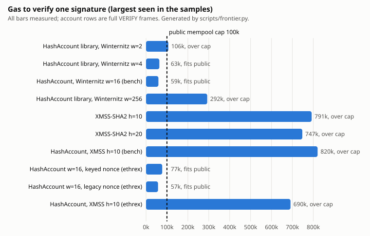

# HashAccount

A post-quantum Ethereum account: no ECDSA key, hash-based one-time signatures (Winternitz keys in a Merkle tree), each key spent through the transaction nonce on the EIP-8141 design, and a measured map of which of those schemes fit the draft public mempool cap of 100,000 gas.

This is an account contract and a signer. It is not a wallet application: there is no browser extension and no hosted service. The result tables use the name HashAccount. The contract files, the Python package, and the nonce tag stay Lamport, after the one-time signature.

Hash-based, believed to resist known quantum attacks. **Unaudited research code. Test keys only.** How this differs from wallets described as quantum-proof is in [docs/PRIOR_ART.md](docs/PRIOR_ART.md). EIP-8141 is not on mainnet. No public-devnet transaction has been sent.

## Status
This is active research. Frame transactions are not live yet, and the account is being prepared for when they are.

- **Waiting for frame transactions.** EIP-8141 is a draft scheduled for the Hegotá upgrade. ethereum.org (updated 16 October 2026) expects Hegotá in the second quarter of 2027, with no confirmed date. The EIP text and client code may still change. The signer follows ethrex `eip8141-tracer` at 9aa3645, which already disagrees with the current EIP text in several places ([docs/SPEC_FACTS.md](docs/SPEC_FACTS.md)). It will be updated when a public frames network settles on one encoding.
- **Tested on a local chain.** Every frame-transaction result here comes from ethrex and the alt-mempool sidecar built from source and run locally, labelled LOCAL. No transaction has been sent to a public devnet or to mainnet.
- **Still optimizing.** On 16 Nov 2026 the Winternitz chain was changed so that only its first step carries the address word, and later steps are a plain 32-byte keccak ([docs/DECISIONS.md](docs/DECISIONS.md)). The largest measured keyed VERIFY frame fell from 95,356 to 77,396 gas, and the runtime from 1,727 to 1,190 bytes. Open work: fit a message that needs all 990 chain steps under the 100,000 cap in keyed mode, cut the 20,000-gas keyed-nonce charge or move it out of the validation budget ([docs/RULE_FINDINGS.md](docs/RULE_FINDINGS.md)), and find a way to deploy inside the frame (the code alone needs about 1.92M state gas against a 500,000 cap).
- **Not reviewed.** There has been no audit and no independent cryptographic review. The trade-off of the 16 Nov chain change is written in [docs/SECURITY.md](docs/SECURITY.md).

## Try it
```sh
./scripts/setup.sh                       # Foundry 1.5.1, solc 0.8.37, Python venv (user-local)
export PATH="$HOME/.foundry/bin:$PATH"
(cd signer && bun install)
./scripts/test_all.sh                    # all tests, 1,000 differential cases, regenerates results/
FULL=1 ./scripts/test_all.sh             # same with 10,000 differential cases (about 6 minutes)
(cd reference && ../.venv/bin/python -m lamport.cli demo)   # sign, verify, refuse reuse, toy forgery
(cd signer && bun test)                  # TypeScript signer against the Python vectors
```
Local EIP-8141 chain (ethrex `eip8141-tracer` built from source, the alt-mempool sidecar, and a small block driver):
```sh
export ETHREX_REPO=/path/to/forshtat-ethrex SIDECAR_DIR=/path/to/mempool-workshop-sidecar   # see docs/DEVNET_RUNBOOK.md section 8
./scripts/local_devnet.sh prepare && ./scripts/local_devnet.sh up
./scripts/local_experiments.sh     # calibration, payments, probes, deploy-state bisection
./scripts/local_inclusion.sh       # inclusion in blocks and reuse attempts
./scripts/local_devnet.sh down
```
Public devnet: see [docs/DEVNET_RUNBOOK.md](docs/DEVNET_RUNBOOK.md). **No public-devnet transaction has been sent yet** (the build workspace cannot reach the devnet).

## Documents
- [docs/PRIOR_ART.md](docs/PRIOR_ART.md): how this differs from wallets described as quantum-proof and from Quip Accounts.
- [docs/PROJECT_EXPLAINED.md](docs/PROJECT_EXPLAINED.md): the project in simple terms.
- [docs/SECURITY.md](docs/SECURITY.md): informal security argument and operating rules.
- [docs/RULE_FINDINGS.md](docs/RULE_FINDINGS.md): rule weaknesses found, with evidence and proposed fixes.
- Demo page: `results/demo.html` (generated by `scripts/demo_page.py`).

## What it does
- **Account** (`contracts/account/LamportAccount.yul.in`): its address is a CREATE2 address over code that holds the key-tree root and a public seed, so no ECDSA key exists for it. Its VERIFY entry reads the signature from an `ARBITRARY` signature entry (`SIGDATACOPY`), verifies it over the canonical signature hash (`TXPARAM(0x08)`), and calls `APPROVE(3)`.
- **One-time keys and the nonce**: 1,024 Winternitz (w = 16, 67 chains) keys in a height-10 tree. Keyed mode (default): leaf `i` of epoch `e` may only be used with `nonce_keys = [LAMP_BASE + (e << 16) + i]` and `nonce_seq = 0`; a key can be at sequence 0 only once. Legacy mode (constructor flag): the account nonce is `e * 1024 + i`. Either way the chain itself refuses a second use of a leaf (shown on the local chain), with no storage write in the read-only VERIFY frame. Keyed mode adds a fixed 20,000 gas inside VERIFY (measured on the one-line control: 107 gas legacy, 20,107 keyed).
- **Signer** (`signer/`, `reference/lamport/signer.py`): finds the next unused leaf from chain state (the NONCE_MANAGER slot in keyed mode, the account nonce in legacy mode), also checks the mempool and an append-only journal, and refuses to sign twice with one leaf.
- **Profiles**: A = this account (aims at the public mempool). B = `contracts/account/LamportXmssAccount.yul.in`, an account whose VERIFY frame calls Skale's XMSS verifier (vendored, unchanged) through `LamportXmssVerifier`; 690,937 to 812,757 gas in the local ethrex runs (`results/local/*xmss*.json`, `send-b-*.json`), so it needs a budget far above 100,000. Its nonce keys use the tag `LMPB`.
- **Key rotation**: when a key tree runs low, a transaction signed by the current tree registers the next one (`cli rotate`). The account stores one commitment per tree (`keccak256(seed || root)`) and checks it with one storage read. Each tree has its own random seed.
- **Exact VERIFY limit**: the signer counts the hash steps of each signature and sets the frame limit from a fitted model (`results/verify_gas_model.json`).
- **Attack view** (`results/attack.html`, from `scripts/attack_view.py`): a stand-in attacker forges toy-size keys after two signatures on one key, and the signer refuses reuse.
- **Local chain** (`scripts/local_devnet.sh`, `scripts/local_experiments.sh`): ethrex `eip8141-tracer` built from source plus the sidecar, for real-opcode runs when the public devnet is out of reach. Results there are labelled LOCAL.
- **Admission simulator** (`simulator/`): checks a transaction and a validation trace against the EIP-8141 public-mempool rules in `simulator/rules.json` (every value with source and date).
- Encoding: [reference/SPEC.md](reference/SPEC.md). Design decisions: [docs/DECISIONS.md](docs/DECISIONS.md). Source facts and what differs on the devnet: [docs/SPEC_FACTS.md](docs/SPEC_FACTS.md).

## Results (generated by scripts)
<!-- results:start -->
Profile A account VERIFY frame (w=16, h=10): mean 53,132 gas, 48,373 to 59,240 over 128 random keys and messages (bench build, results/account_bench_gas.json). Signature 2,468 bytes.

VERIFY limit = largest gas seen in the samples. Public rule: declared VERIFY limit + 100 (ARBITRARY) <= 100,000. Alt-mempool budget: unknown (no devnet value yet).
Rows named 'HashAccount' are full account VERIFY frames. Other rows are the verifier call alone (no frame adjustment; for comparison the w=16 library call max is 58,704 and the w=16 account frame max is 59,240).

The transaction pays the larger of its standard calldata total and its floor total. On this local build neither term counts toward MAX_VERIFY_GAS (OPEN_QUESTIONS Q1). The signer sets its own VERIFY limit from results/verify_gas_model.json, not from the sample maximum in this table.

| scheme | signature bytes | VERIFY gas mean | VERIFY gas max | basis | standard data gas (16/byte) | floor term (64/byte) | public mempool | alt mempool |
|---|---|---|---|---|---|---|---|---|
| HashAccount library, Winternitz w=2 | 8,804 | 104,568 | 106,749 | measured library call only | 140,864 | 563,456 | REFUSED | UNKNOWN |
| HashAccount library, Winternitz w=4 | 4,580 | 60,993 | 63,646 | measured library call only | 73,280 | 293,120 | ACCEPTED | UNKNOWN |
| HashAccount, Winternitz w=16 (Profile A) | 2,468 | 53,132 | 59,240 | measured (account VERIFY frame, bench build) | 39,488 | 157,952 | ACCEPTED | UNKNOWN |
| HashAccount library, Winternitz w=256 | 1,412 | 240,465 | 292,623 | measured library call only | 22,592 | 90,368 | REFUSED | UNKNOWN |
| XMSS-SHA2 h=10 (Skale, vendored) | 2,500 | 723,470 | 791,963 | measured library call only | 40,000 | 160,000 | REFUSED | UNKNOWN |
| XMSS-SHA2 h=20 (Skale, vendored) | 2,820 | 724,727 | 747,520 | measured library call only | 45,120 | 180,480 | REFUSED | UNKNOWN |
| HashAccount, XMSS h=10 (Profile B) | 2,500 | 752,704 | 820,572 | measured (account VERIFY frame incl. verifier call, bench build) | 40,000 | 160,000 | REFUSED | UNKNOWN |
| HashAccount, w=16, keyed nonce (Profile A) on ethrex | 2,468 | 73,067 | 77,396 | LOCAL ethrex simulation, real opcodes incl. 20,000 keyed-nonce charge | 39,488 | 157,952 | ACCEPTED | UNKNOWN |
| HashAccount, w=16, legacy nonce (Profile A) on ethrex | 2,468 | 52,524 | 57,356 | LOCAL ethrex simulation, real opcodes | 39,488 | 157,952 | ACCEPTED | UNKNOWN |
| HashAccount, XMSS h=10 (Profile B) on ethrex | 2,500 | 690,937 | 690,937 | LOCAL ethrex simulation, real opcodes incl. 20,000 keyed-nonce charge (1 sample) | 40,000 | 160,000 | REFUSED | UNKNOWN |

Per-phase gas: [results/gas.md](results/gas.md). Differential test: [results/differential_10000.txt](results/differential_10000.txt).
<!-- results:end -->



Admission results with explorer links: none yet; the public devnet has not been reached (see the runbook).

### Local chain (LOCAL ethrex + sidecar, not the public devnet)
<!-- local:start -->
LOCAL ethrex `eip8141-tracer` + local sidecar, not the public devnet. The first table holds ethrex simulations (real EIP-8141 opcodes) and the sidecar's admission verdicts; the inclusion table uses blocks built by scripts/local_blocks.py through the Engine API. The probes' second frame fails for an unrelated reason: it sends 1 wei to a new address with no state gas; only their VERIFY frame matters.

| experiment | ethrex simulation (per frame) | sidecar verdict | file |
|---|---|---|---|
| banned | frame 0: ok, 20,111 gas; frame 1: failed, 33,000 gas | REFUSED: payer uses banned opcode: TIMESTAMP | `probe-banned.json` |
| bigsig | frame 0: ok, 72,971 gas; frame 1: ok, 3,000 gas | ACCEPTED into the sidecar mempool (0xd3a91605e7b09937...) | `probe-bigsig.json` |
| control-legacy | frame 0: ok, 107 gas; frame 1: failed, 33,000 gas | ACCEPTED into the sidecar mempool (0x320d01892626a86f...) | `probe-control-legacy.json` |
| control | frame 0: ok, 20,107 gas; frame 1: failed, 33,000 gas | ACCEPTED into the sidecar mempool (0xa790c19500db8b04...) | `probe-control.json` |
| deploy | frame 0: ok, 28,430 gas; frame 1: ok, 70,197 gas; frame 2: ok, 3,000 gas | REFUSED: validation prefix execution gas sum 476208 + signature-verification cost 100 = 476308 exceeds MAX_VERIFY_GAS 100000 | `probe-deploy.json` |
| Profile A payment (keyed nonce) | frame 0: ok, 69,344 gas; frame 1: ok, 3,000 gas | ACCEPTED into the sidecar mempool (0xfbb1cb39f5c223b0...) | `send-2026-11-16T05-27-28.807Z.json` |
| Profile A payment (legacy nonce) | frame 0: ok, 52,966 gas; frame 1: ok, 3,000 gas | ACCEPTED into the sidecar mempool (0xd77812a3244d661e...) | `send-2026-11-16T05-27-31.880Z.json` |
| Profile B payment | frame 0: ok, 690,937 gas; frame 1: ok, 3,000 gas | REFUSED: validation prefix execution gas sum 900000 + signature-verification cost 100 = 900100 exceeds MAX_VERIFY_GAS 100000 | `send-b-2026-11-16T05-27-31.923Z.json` |

Real VERIFY frame gas on ethrex (simulation, high limit, each sample a fresh leaf):

| frame | samples | min | mean | max | file |
|---|---|---|---|---|---|
| Profile A VERIFY frame, keyed nonce | 48 | 68,920 | 73,067 | 77,396 | `calibration_keyed.json` |
| Profile A VERIFY frame, legacy nonce | 48 | 48,929 | 52,524 | 57,356 | `calibration_legacy.json` |

Inclusion on the local chain (blocks built by scripts/local_blocks.py through the Engine API):

| transaction | leaf | included | leaf state before -> after | same leaf again | same leaf, next sequence | signer | file |
|---|---|---|---|---|---|---|---|
| Profile A, keyed nonce | leaf 50 | block 2, status 0x1 | key sequence 0 -> key sequence 1 | node: Invalid Transaction: Nonce mismatch: expected 1, got 0; sidecar: Invalid Transaction: Nonce mismatch: expected 1, got 0 | validation frame 0: reverted | refused: leaf 50 is already used or pending; refusing to sign; next leaf 51 | `inclusion-keyed.json` |
| Profile A, legacy nonce | leaf 1 | block 3, status 0x1 | account nonce 1 -> account nonce 2 | node: Invalid Transaction: Nonce mismatch: expected 2, got 1; sidecar: Invalid Transaction: Nonce mismatch: expected 2, got 1 | validation frame 0: reverted | refused: leaf 1 is already used or pending; refusing to sign; next leaf 2 | `inclusion-legacy.json` |
| Profile B, node budget raised to 1,000,000 (no sidecar) | leaf 1 | block 2, status 0x1, VERIFY 736,622 gas | slot 0 -> 1 | n/a | n/a | n/a | `inclusion-xmss-raised-node-budget.json` |
| Profile B through the PATCHED sidecar (budget 1,000,000, precompiles listed; docs/RULE_FINDINGS.md) | leaf 3 | accepted by the sidecar, relayed, block 2, status 0x1, VERIFY 812,757 gas | slot 0 -> 1 | n/a | n/a | n/a | `inclusion-xmss-patched-sidecar.json` |
| Profile B, default node budget 100,000 (no sidecar) | leaf 2 | refused at submission: Invalid params: Frame transaction prefix gas budget (frames + sig cost) exceeds MAX_VERIFY_GAS | n/a | n/a | n/a | n/a | `node-xmss-default-budget.json` |

Key rotation on the local chain (`rotation/summary.json`):

- Rotation signed with epoch-0 leaf 51: block 2, status 0x1; last epoch now 1; slot 1 holds the new tree's commitment: True.
- Payment with the epoch-1 key (leaf 0): block 3, status 0x1, VERIFY 75,802 gas.
- Payment with an unregistered epoch-2 key: node Invalid Transaction: Invalid frame transaction: VERIFY frame 0 (target 0x94f002277b8888115c98e66ff344c3ecffc8ace0, 1190 bytes of code) failed: RevertOpcode; sidecar: validation frame 0: reverted.

Deploy + self_verify in one transaction: the deploy frame needs between 1,917,968 and 1,918,639 state gas (1,190 runtime bytes x 1,530 = 1,820,700); the public cap is 500,000: deploy + self_verify cannot pass the public state-gas cap (`deploy_state.json`).

Raw responses: results/local/. Generated by scripts/local_report.py.
<!-- local:end -->

Attack view: [results/attack.md](results/attack.md) and the page `results/attack.html`.

**Findings on the alternative mempool:** the sidecar at fcb4885 applies the 100,000 validation cap to every transaction and, by default, refuses calls to precompiles, so it refuses Profile B just like the public mempool. With our 26-line patch (`patches/sidecar-configurable-verify-budget.patch`) and the precompile list set, the local sidecar accepted Profile B, relayed it, and it was included. All findings and proposed fixes: [docs/RULE_FINDINGS.md](docs/RULE_FINDINGS.md).

## What is reused and what is ours
| Part | Source | Licence |
|---|---|---|
| XMSS Python reference (Profile B test signing), `reference/xmss/xmss_ref.py` | skalenetwork/xmss-solidity `py/` @749593d, unchanged | MIT, notice in `reference/xmss/LICENSE` |
| ethrex `eip8141-tracer`, mempool-workshop-sidecar (local chain only, not vendored) | forshtat/ethrex @9aa3645, forshtat/mempool-workshop-sidecar @fcb4885 | MIT/Apache-2.0, MIT |
| XMSS verifier (Profile B), `contracts/src/xmss/XMSS.sol` and its test vectors | [skalenetwork/xmss-solidity](https://github.com/skalenetwork/xmss-solidity) @749593d, unchanged. Formally checked against RFC 8391 (Halmos), not audited | MIT, notice in `contracts/src/xmss/LICENSE` |
| forge-std (test only) | foundry-rs/forge-std v1.9.7, fetched by setup | MIT / Apache-2.0 |
| viem | npm | MIT |
| @ethereumjs/rlp (test only, independent encoder check) | npm | MPL-2.0 |
| pycryptodome (keccak), pytest, hypothesis | PyPI | BSD / Public domain, MIT, MPL-2.0 |
| Frame transaction field order and signature hash on the devnet | read from forshtat/ethrex `eip8141-tracer` and forshtat/mempool-workshop-sidecar (not copied) | n/a |
| Winternitz scheme, encoding, Solidity library, Yul account, Python reference, TypeScript signer, simulator, scripts | ours | MIT |

## Security model and limits
- Protects: the account's own authorisation. There is no ECDSA key to steal. Each one-time key signs one transaction hash, and the chain refuses a second use of its nonce key.
- Signing reuse is the main danger: two signatures with one leaf allow forgery (the demo shows it with toy parameters). The signer reads used leaves from chain and keeps a journal; a signature produced but never broadcast and whose journal entry was lost must be destroyed.
- No fee bump: replacing a transaction would need a second signature on the same leaf. The signer sets a generous `max_fee` instead.
- Not protected: legacy EOAs and their funds; builder and mempool visibility of plaintext transactions; quantum risk to consensus, ZK systems and other contracts; lost-key recovery. EIP-8141 itself "does not solve post-quantum security" (roadmap page, not re-read).
- Key rotation adds the next tree; it does not revoke earlier ones (they stay limited by their spent nonces). If a secret seed leaks, move funds to a new account.
- Keyed mode's largest measured VERIFY frame is 77,396 gas (`results/local/calibration_keyed.json`). A message that takes all 990 chain steps is predicted at 99,001 gas before the signer's 2,000-gas margin, and the keyed signer refuses it. Legacy mode's largest measured frame is 57,356 gas; the same 990-step message is predicted at 79,089 gas before that margin, so the legacy limit still fits the cap (`results/verify_gas_model.json`, `results/verify_gas_model_legacy.json`). Legacy mode is strictly sequential.
- The account must be deployed in an earlier transaction: deploying it inside the frame needs about 1.92M state gas (`results/local/deploy_state.json`), over the 500,000 public cap.
- Profile B may have no admission path today: the sidecar code we read caps validation at 100,000 gas for every transaction.
- Local-chain results come from our own ethrex node, sidecar and block driver; they are not public-devnet admissions.
- Gas: the admission column uses the largest gas seen in random samples, not a proven worst case. A message whose digits are all small costs more; the signer sets the VERIFY limit with margin.
- Bench-build gas figures exclude the 20,000-gas keyed-nonce charge; real-opcode figures come from a local ethrex build (`results/local/`), not the public devnet. The devnet's ethrex build differs from the EIP text in several places (docs/SPEC_FACTS.md); the signer follows the devnet.
- Unaudited research code. Hash-based, believed to resist known quantum attacks.

## What changes for a holder
On the frame-transaction account, once a leaf is included, the local node refuses a second use of that nonce key. The account pays its own fees (`self_verify`). There is no ECDSA owner key in the account. Signatures are hash-based, believed to resist known quantum attacks. That property is measured on a local ethrex build. It is not a mainnet result. Unaudited research code: see docs/SECURITY.md. The comparison with other approaches is in docs/PRIOR_ART.md.

## Licence
MIT (see `LICENSE`). Vendored code keeps its own licence notice.
